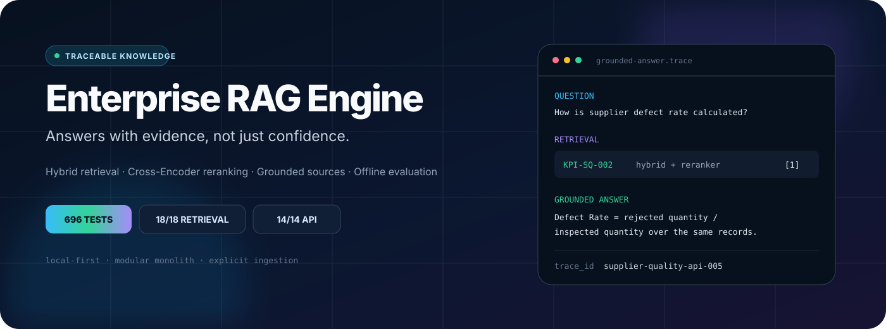
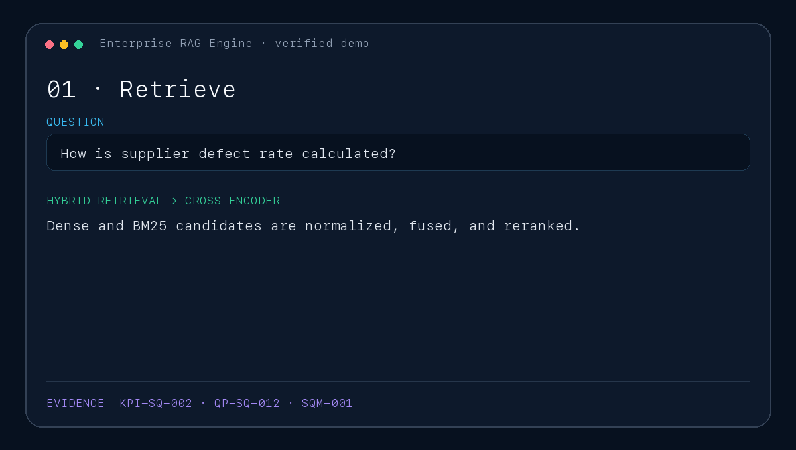
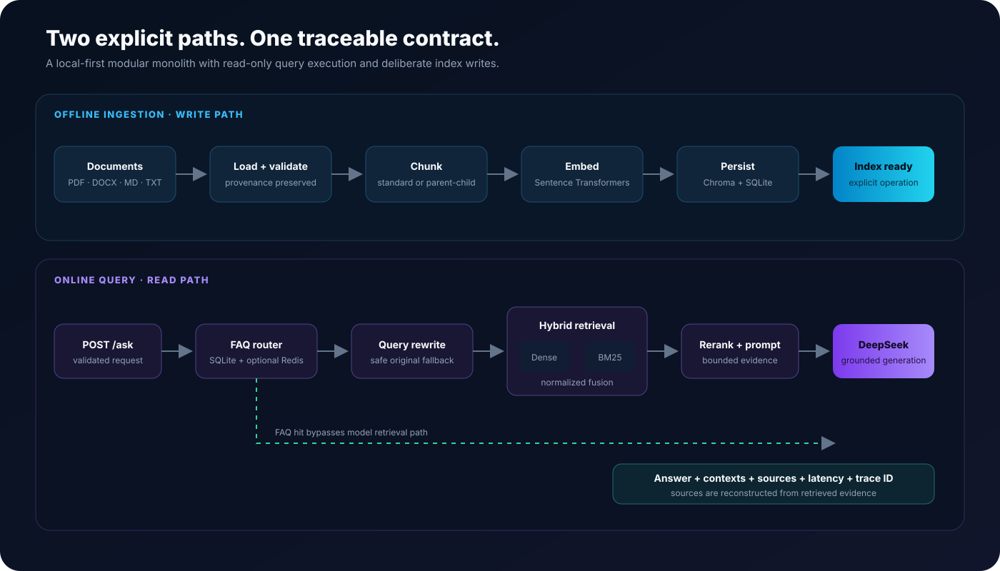

<p align="center">
  
</p>

<h1 align="center">Enterprise RAG Engine</h1>

<p align="center">
  A test-backed enterprise knowledge assistant with hybrid retrieval, Cross-Encoder reranking,<br>
  grounded sources, explicit abstention, and an offline quality-evaluation loop.
</p>

<p align="center">
  <a href="https://github.com/MaxLee1218/Enterprise-RAG-Engine/actions/workflows/ci.yml"></a>
  
  
  
  <a href="LICENSE"></a>
  
</p>

<p align="center">
  <a href="#verified-demo">Demo</a> ·
  <a href="#architecture">Architecture</a> ·
  <a href="#quick-start">Quick start</a> ·
  <a href="#quality-evidence">Quality evidence</a> ·
  <a href="#engineering-decisions">Engineering decisions</a>
</p>

> [!IMPORTANT]
> This is a local-first, production-oriented reference implementation—not a
> claim of production deployment. It demonstrates explicit contracts,
> traceability, testing, evaluation, and predictable failure behavior using a
> synthetic Supplier Quality corpus.

## The 30-second view

| Enterprise problem | Engineering response | Repository evidence |
|---|---|---|
| Meaning and exact terminology both matter | Sentence Transformer dense search + BM25 + deterministic score fusion + optional Cross-Encoder | [Retrieval implementation](app/hybrid_retriever.py) and 18/18 positive retrieval gates |
| Answers must be traceable | Stable chunk metadata, bounded evidence prompts, deterministic source reconstruction, request trace IDs | [RAG contract](rag_spec.md) and [API contract](docs/rag_api_contract.md) |
| RAG changes can silently regress quality | Offline datasets, retrieval/abstention metrics, RAGAS adapters, latency analysis, bad-case export/import | [Evaluation pipeline](evaluation/) and checked-in reports |
| Index writes carry compatibility risk | Ingestion is explicit and offline; normal query execution never rebuilds the index | [Ingestion ADR](docs/adr/0003-explicit-ingestion.md) |

| Verification snapshot | Result |
|---|---:|
| Offline automated tests | **696 passing** |
| Supplier Quality positive retrieval gates | **18 / 18** |
| Supplier Quality HTTP smoke scenarios | **14 / 14** |
| No-evidence HTTP scenarios | **2 / 2 abstained** |
| Controlled demo corpus | **5 PDFs · 20 pages · 81 chunks** |

The test count is reproducible with `python -m pytest -q`. Supplier Quality
figures are dated synthetic-corpus evidence from the checked-in
[retrieval](reports/supplier_quality_retrieval_report.json) and
[HTTP](reports/supplier_quality_api_report.json) reports—not production SLIs.

## Verified demo

<p align="center">
  
</p>

The animation is generated from checked-in HTTP smoke evidence by
[`scripts/generate_readme_demo.py`](scripts/generate_readme_demo.py). It shows
both a grounded answer and the exact no-evidence response:

```text
Not found in knowledge base.
```

Run the API and open [`http://localhost:8000/demo`](http://localhost:8000/demo)
for the read-only browser client. It displays the answer, retrieved source
previews, latency, and trace ID returned by the existing `POST /ask` contract.
It cannot upload documents or mutate the index.

## Architecture

<p align="center">
  
</p>

The default architecture is a modular monolith. It keeps transport,
orchestration, retrieval, generation, and persistence responsibilities
separate without introducing distributed infrastructure that the current scale
does not require.

### Online request path

1. Validate the request and establish a trace/session identifier.
2. Try the maintained FAQ fast path through SQLite and an optional Redis cache.
3. On a miss, rewrite conversation-dependent queries with safe fallback to the
   original wording.
4. Retrieve dense and lexical candidates, normalize component scores, and fuse
   them deterministically.
5. Optionally rerank candidates with a Cross-Encoder; model failures fall back
   to retrieval order.
6. Build a bounded evidence-only prompt and call DeepSeek.
7. Reconstruct reported sources from retrieved contexts rather than trusting
   model-authored source text.

### Offline ingestion path

```text
discover → load → preserve provenance → chunk → embed → persist → report
```

PDF, DOCX, Markdown, and TXT loaders feed standard or parent–child chunking.
Embeddings and flat provenance metadata are stored in Chroma; parent–child mode
uses SQLite for larger parent contexts. Index-changing behavior is never an
incidental side effect of a query.

## What makes this more than a RAG demo

- **Traceability by construction** — source identity and chunk metadata cross
  ingestion, retrieval, prompt, response, and evaluation boundaries.
- **Complementary retrieval signals** — dense similarity handles paraphrases;
  BM25 protects exact policy terms, identifiers, and thresholds.
- **Controlled degradation** — query rewriting, reranking, and Redis caching
  have explicit fallback behavior.
- **Evidence-bound generation** — prompt size is bounded, abstention is part of
  the contract, and source rows come only from retrieved contexts.
- **Evaluation as a subsystem** — datasets, RAGAS adapters, stage latency,
  structured reports, and a reviewed bad-case loop live in the repository.
- **Safe index lifecycle** — dry-run, isolated demo collections, stable IDs,
  explicit reset, and guarded demo-index deletion make mutations visible.

## Quick start

### Docker Compose

Requirements: Docker Compose and a DeepSeek API key for deep-path answers.

```bash
git clone https://github.com/MaxLee1218/Enterprise-RAG-Engine.git
cd Enterprise-RAG-Engine
cp .env.example .env

# Build the image and explicitly ingest the synthetic PDFs once.
docker compose --profile tools run --rm ingest

# Start the API and Redis cache.
docker compose up -d api

curl --fail http://127.0.0.1:8000/health
```

Then open `http://127.0.0.1:8000/demo`. The API can be process-healthy before
the knowledge index or provider is ready; `/health` is deliberately a
lightweight liveness endpoint.

### Local Python

```bash
python3.11 -m venv .venv
source .venv/bin/activate
python -m pip install -r requirements.txt
cp .env.example .env

python scripts/ingest.py \
  --input enterprise-documents/pdf \
  --extensions .pdf \
  --persist-path data/supplier_quality/chroma \
  --collection supplier_quality_demo

uvicorn app.api:app --reload
```

Ask directly from the terminal:

```bash
python scripts/ask.py "How is supplier defect rate calculated?"
```

Or inspect retrieval without calling the generator:

```bash
python scripts/query.py --query "supplier corrective action"
```

See the complete [Docker runtime guide](docs/docker.md) for persistence,
explicit rebuilds, resource observations, and troubleshooting.

## API contract

```bash
curl --fail-with-body -X POST http://127.0.0.1:8000/ask \
  -H 'Content-Type: application/json' \
  -H 'X-Trace-ID: portfolio-demo-001' \
  -d '{"question":"How is supplier defect rate calculated?"}'
```

```json
{
  "answer": "Defect Rate = Defect Count / Inspected Count [1].",
  "sources": [
    {
      "index": 1,
      "source": "Supplier_Quality_KPI_Definitions.pdf",
      "metadata": {"document_id": "KPI-SQ-002", "version": "1.4"},
      "text_preview": "..."
    }
  ],
  "contexts": [
    {
      "content": "Defect Rate = Defect Count / Inspected Count...",
      "source": "Supplier_Quality_KPI_Definitions.pdf",
      "chunk_id": "supplier_quality_kpi_definitions-4640bf1da0-chunk-7",
      "score": null,
      "metadata": {"document_id": "KPI-SQ-002", "version": "1.4"}
    }
  ],
  "route": "rag",
  "latency_ms": 1489,
  "rag_trace_id": "portfolio-demo-001"
}
```

The shortened response above illustrates the stable shape; the complete
request/response and error semantics are documented in
[`docs/rag_api_contract.md`](docs/rag_api_contract.md).

## Quality evidence

Quality is measured at retrieval, generation, abstention, and latency
boundaries rather than inferred from a single attractive answer.

### Reproducible offline gate

```bash
python -m pytest -q
python scripts/validate_enterprise_documents.py
```

Normal tests inject or mock external providers and do not require network
access or model downloads. They cover loading, metadata, chunking, embeddings,
vector persistence, BM25, score fusion, parent–child resolution, reranking,
prompt bounds, provider errors, citations, API/CLI contracts, FAQ routing,
conversation isolation, evaluation, Docker, and synthetic artifacts.

### Dated evaluation snapshot

| Metric | Score | Scope |
|---|---:|---|
| Retrieval hit rate | 1.0000 | 8 answerable cases |
| Abstention accuracy | 1.0000 | 2 no-evidence cases |
| Faithfulness | 0.8000 | 10 cases |
| Answer relevancy | 0.6103 | 10 cases |
| Context precision | 0.8167 | 10 cases |
| Context recall | 0.9000 | 10 cases |
| Total latency p50 | 1066 ms | 10 cases |

These are historical results from the synthetic 10-case dataset, generated on
2026-07-15 with the configuration recorded in
[`reports/evaluation_report.json`](reports/evaluation_report.json). They are
useful as a checked-in baseline, not as a production or broad-domain benchmark.
The newer 20-case Supplier Quality run has complete retrieval and HTTP gates;
its provider-dependent RAGAS stage remains explicitly incomplete.

Run evaluation only after authorizing the configured external provider to
receive the selected document context:

```bash
python eval/run_eval.py
```

## Engineering decisions

| Decision | Benefit | Accepted limitation |
|---|---|---|
| [Modular monolith](docs/adr/0001-modular-monolith.md) | Clear boundaries with low operational overhead | One process still shares blocking and resource pressure |
| [Dense + BM25 fusion](docs/adr/0002-hybrid-retrieval.md) | Semantic recall plus exact enterprise terminology | In-memory lexical index and uncalibrated normalized scores |
| [Explicit offline ingestion](docs/adr/0003-explicit-ingestion.md) | Predictable queries and auditable index writes | Operators must run ingestion and rebuilds deliberately |
| Parent–child alternative | Precise child retrieval with broader generation context | Separate SQLite consistency boundary; default mode is standard hybrid |
| Deterministic source reconstruction | Prevents fabricated model source rows | Does not prove that every generated claim is supported |

The detailed behavioral and data-contract specification is in
[`rag_spec.md`](rag_spec.md).

## Technology map

| Boundary | Implementation |
|---|---|
| HTTP and validation | FastAPI · Pydantic · Uvicorn |
| Dense retrieval | Sentence Transformers · ChromaDB |
| Lexical retrieval | BM25 · Jieba for FAQ matching |
| Final ranking | Sentence Transformers Cross-Encoder |
| Generation and rewriting | DeepSeek OpenAI-compatible API |
| Local persistence | Chroma · SQLite · optional Redis cache |
| Evaluation | RAGAS · deterministic retrieval/abstention metrics |
| Verification | Pytest · contract tests · opt-in smoke harnesses |
| Runtime | Python 3.11 · multi-stage non-root Docker image |

## Repository map

```text
app/
  conversation/         bounded process-local history
  faq/                  maintained-answer fast path and cache
  query_rewriter/       rewrite interface and providers
  api.py                HTTP transport
  pipeline.py           deep RAG orchestration
  pipeline_factory.py   configured composition
  hybrid_retriever.py   dense/sparse fusion
  reranker.py           optional Cross-Encoder
  prompt_builder.py     bounded context and source reconstruction
evaluation/             datasets, metrics, latency, RAGAS, reports
enterprise-documents/   controlled synthetic Supplier Quality corpus
scripts/                ingestion, CLI, admin, smoke, and safety tools
tests/                  offline unit, integration, and contract tests
docs/                   runtime, API, and architecture decisions
```

## Current boundaries

Being explicit about what is not implemented is part of the engineering story:

- no production-user, availability, capacity, or compliance evidence;
- no authentication, authorization, tenancy, or document ACL enforcement;
- process-local conversation history is not shared across workers;
- whole-document PDF loading does not retain page/section provenance;
- no automatic stale-chunk reconciliation or general index migration tooling;
- BM25 is rebuilt in memory when the standard pipeline is constructed;
- prompt grounding and source validation are not full claim-level verification;
- `/health` reports process liveness, not provider or index readiness;
- provider-dependent evaluation cost and reproducibility remain external.

See [SECURITY.md](SECURITY.md) before exposing the service beyond a trusted
local environment.

## 90-second interview walkthrough

1. Start with the two lanes in the architecture diagram: ingestion owns writes;
   query execution is read-only.
2. Follow an FAQ miss through conversation-aware rewriting, dense + BM25
   retrieval, deterministic fusion, reranking, and a bounded prompt.
3. Show that sources are rebuilt from retrieved contexts and carry stable
   document/chunk metadata plus a trace ID.
4. Run one answerable and one no-evidence case in `/demo`.
5. Finish with the offline test gate, dated evaluation evidence, and the
   limitations above—the project demonstrates engineering judgment, not an
   unsupported “production-ready” claim.

## Project status

Implemented: ingestion, dense/BM25/hybrid retrieval, optional reranking,
parent–child retrieval, FAQ routing, conversation-aware rewriting, grounded
generation, API/CLI, offline evaluation, bad-case tooling, synthetic corpus,
CI definition, Docker runtime, Compose topology, and read-only demo.

Next evidence-driven improvements include readiness diagnostics, page-aware PDF
provenance, stale-chunk reconciliation, claim-level citation validation, and
deployment-specific identity/access controls.

Contributions are welcome through [CONTRIBUTING.md](CONTRIBUTING.md). Release
scope is recorded in [CHANGELOG.md](CHANGELOG.md).

## License

Licensed under the [Apache License 2.0](LICENSE). It permits commercial and
private use, modification, and redistribution while retaining attribution and
providing an explicit patent grant.
